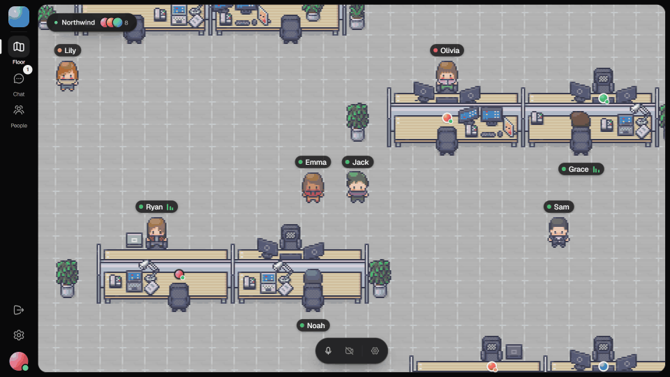
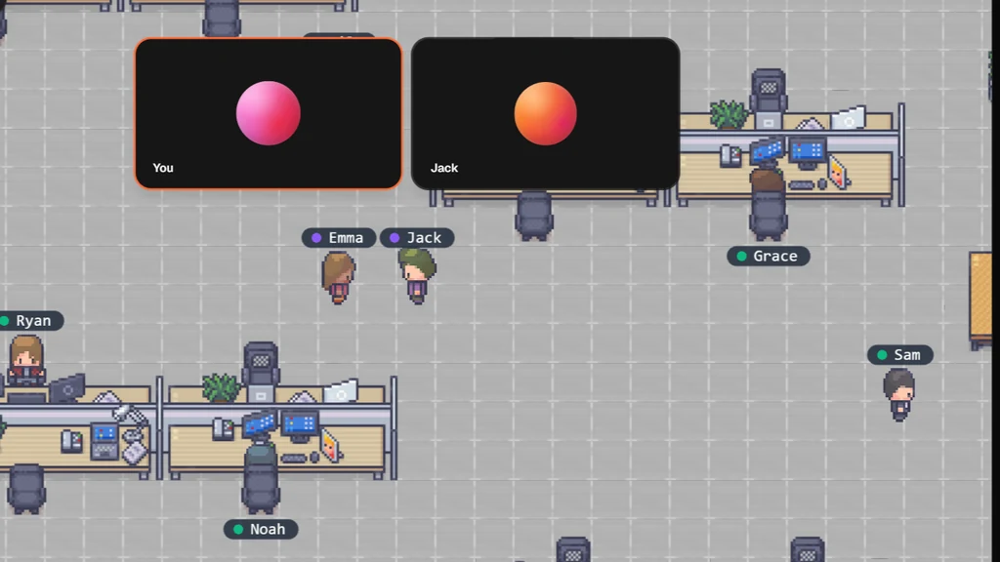
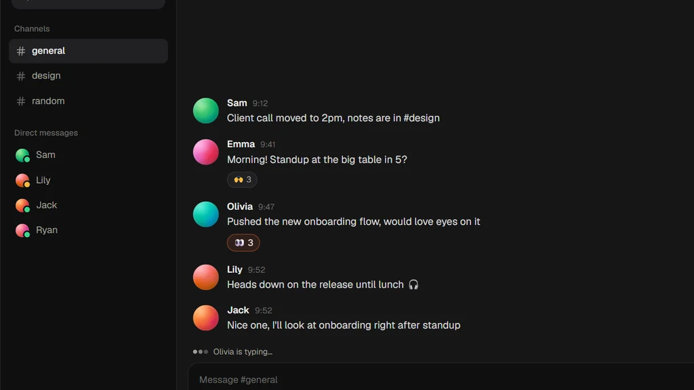
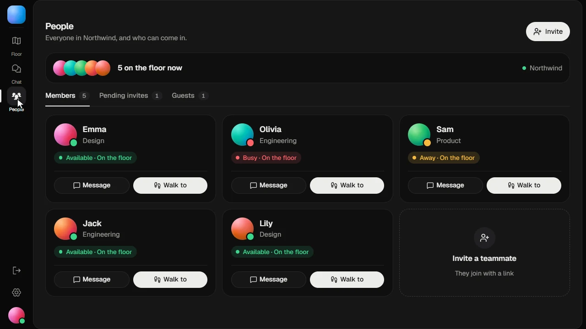

  <a href="https://www.tinyfloor.com">
    <picture>
      <source media="(prefers-color-scheme: dark)" srcset=".github/readme/logo-dark.svg">
      
    </picture>
  </a>

<h1 align="center">TinyFloor</h1>

  <b>The virtual office your team can walk around in.</b> 
  Walk up to someone to talk. Pull up a chair to meet. Free for up to 3 people.

  <a href="https://www.tinyfloor.com"><b>Website</b></a> ·
  <a href="https://www.tinyfloor.com/lobby"><b>Try the demo office</b></a> ·
  <a href="https://www.tinyfloor.com/create"><b>Make an office</b></a> ·
  <a href="#pricing"><b>Pricing</b></a> ·
  <a href="#questions"><b>Questions</b></a>

  
  
  

  <a href="https://www.tinyfloor.com/lobby">
    <picture>
      <source srcset=".github/readme/tour.avif" type="image/avif">
      
    </picture>
  </a>

## A virtual office for remote teams

Remote work lost the hallway: the quick question at someone's desk, the hello on the way past, seeing who's around. Video calls turned every one of those into a scheduled meeting.

TinyFloor is a small virtual office in your browser. Your team works on a shared pixel-art floor, each at a desk of their own, and **proximity video chat** does the rest: walk up to someone to talk, walk into the meeting room to meet, walk out when you're done. The office stays open all day, so remote work feels like working side by side again.

It's a hosted service at **[tinyfloor.com](https://www.tinyfloor.com)**: make an office in a minute, send your team the invite, and you're working together. There's nothing to install or run. It's made for small teams that work together every day.

## Features

<table>
  <tr>
    <td width="33%"></td>
    <td width="33%"></td>
    <td width="33%"></td>
  </tr>
  <tr>
    <td><b>Proximity video calls</b> Walk up to a teammate and one tap starts a call.</td>
    <td><b>Team chat</b> Channels, direct messages and reactions that stay.</td>
    <td><b>Presence</b> See who's in, busy or in a call, then walk right over.</td>
  </tr>
</table>

- **A meeting room** for group video calls with screen sharing: walk in to join, walk out to leave. Meetings get a full page too, with whoever's talking up front.
- **Your own desk.** Sit down and make it yours; from then on you arrive at it, and teammates walking past see whose it is.
- **Invites that get sent:** copy the link, copy a ready message for your team's chat, email it, or share it from your phone. Teammates pick a name and a character and join with a free account.
- **A whiteboard** for the moments between calls, and noise removal for the calls themselves.
- **What you're listening to:** share a Spotify song, playlist or Jam on your profile, and teammates listen from your card.
- **Works in the browser** on desktop and mobile, with nothing to download, in 18 languages.
- **Private offices** for your team, joined by invite, and a demo office to try it first.

## Made for

- **[Engineering teams](https://www.tinyfloor.com/engineering-teams)**, **[design teams](https://www.tinyfloor.com/design-teams)**, **[startups](https://www.tinyfloor.com/startups)** and **[agencies](https://www.tinyfloor.com/agencies)**.
- **[Virtual office](https://www.tinyfloor.com/virtual-office)**: one room your remote team keeps open all day.
- **[Virtual standup](https://www.tinyfloor.com/virtual-standup)**, **[remote pair programming](https://www.tinyfloor.com/remote-pair-programming)** and **[remote onboarding](https://www.tinyfloor.com/remote-onboarding)**.
- **[Virtual coworking](https://www.tinyfloor.com/virtual-coworking)**: heads-down hours with your team, and a **[virtual watercooler](https://www.tinyfloor.com/virtual-watercooler)** between them.

## Pricing

One price for the whole office, never one per person.

| Plan | Price | For |
|---|---|---|
| **Free** | $0, forever, no card | Up to 3 people, with the floor, chat, HD meetings, desks and everything else |
| **Pro** | $29 a month, for the whole team | Your whole team, meetings as often as you need, and priority help |

- **A trial when the team arrives:** when a 4th person joins a free office, the whole team gets Pro free for 14 days.
- **Cancel any time**, and ask within 14 days of any payment for a full refund.
- **Made for small teams** that work together every day, up to 15 people in an office.
- Prices are in US dollars, before tax. Payments go through Creem, our reseller. [See the pricing page](https://www.tinyfloor.com/pricing).

**What a team of 10 pays each month:** $29 on TinyFloor Pro ($2.90 a person), against $80 to $160 on tools priced per person at $8 to $16 a seat.

## Compared with other virtual offices

Moving from [Gather](https://www.tinyfloor.com/gather-alternative), [Kumospace](https://www.tinyfloor.com/kumospace-alternative), [SpatialChat](https://www.tinyfloor.com/spatialchat-alternative), [WorkAdventure](https://www.tinyfloor.com/workadventure-alternative), [Wonder](https://www.tinyfloor.com/wonder-alternative), [Sococo](https://www.tinyfloor.com/sococo-alternative), [oVice](https://www.tinyfloor.com/ovice-alternative), [Roam](https://www.tinyfloor.com/roam-alternative) or [Teamflow](https://www.tinyfloor.com/teamflow-alternative)? TinyFloor keeps the core of a virtual office and does it well: moving around, proximity calls, a meeting room, screen sharing and chat, for one flat price. Each link compares the two side by side, and there's [every comparison in one place](https://www.tinyfloor.com/compare).

TinyFloor deliberately leaves things out: there are no custom map editors, recordings or AI meeting notes. If your team wants a simple office that stays open all day, that's what it does.

## Questions

### How does proximity video chat work?

Walk up to someone and a call button appears next to them. A call starts with voice, and the camera and screen sharing are one tap away. Calls run over WebRTC through Cloudflare's network, so they connect on any office or home network. Three or more people meet in the meeting room.

### Do I need to install anything?

No. TinyFloor runs in any modern browser on desktop and mobile. Open a link and you're in the office.

### How is it different from Zoom or Google Meet?

Zoom and Meet put everyone in one grid until the meeting ends. A TinyFloor office stays open all day, so you can see who's around and talk to whoever you walk over to, without scheduling a call.

### Is it private?

An office is only for its members. Nothing inside it is public or indexed, and calls are encrypted in transit.

### Is TinyFloor free?

Yes, for up to 3 people, with every feature and no card. When the team grows, Pro is $29 a month for the whole team, and the first 14 days are free.

### Can I try it without signing up?

Yes. The [demo office](https://www.tinyfloor.com/lobby) needs only a name. Making your own office takes a free account with Google or email.

### Is it open source?

Yes, under the AGPL v3.0. The code is here, and the hosted service at tinyfloor.com is how teams use it: it runs on Cloudflare's network, with calls, chat and storage taken care of.

## Open source

TinyFloor's code is open source under the [GNU AGPL v3.0](LICENSE). It runs on Cloudflare Workers, Durable Objects and D1, with a Next.js front end. The TinyFloor name and logo are ours, and the pixel art belongs to its artists ([credits](web-shared/public/credits.txt), [ASSETS.md](ASSETS.md)).

Questions or ideas? Write to [support@tinyfloor.com](mailto:support@tinyfloor.com).
